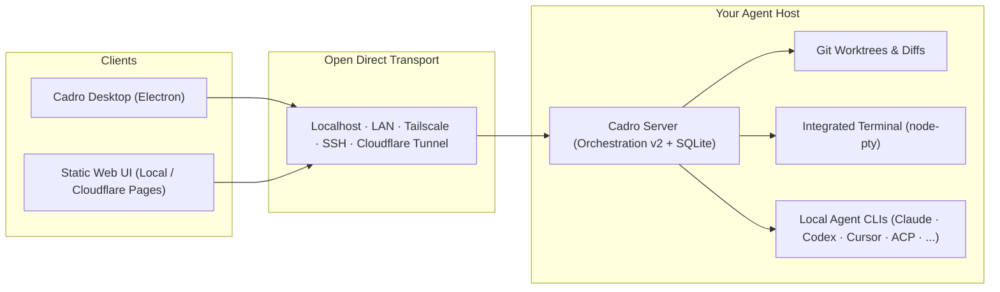

<p align="center">
  
</p>

<h1 align="center">Cadro</h1>

<p align="center">
  <strong>Open-source, self-hostable workbench for running multiple coding agents.</strong><br />
  Codex-inspired desktop &amp; web UI · Multi-agent orchestration · Zero telemetry · Zero closed relay
</p>

<p align="center">
  <a href="https://github.com/AnnaSuSu/Cadro/releases/latest">
    
  </a>
  <a href="https://github.com/AnnaSuSu/Cadro/actions/workflows/ci.yml">
    
  </a>
  <a href="./LICENSE">
    
  </a>
  
  <a href="#audit-the-source">
    
  </a>
</p>

<p align="center">
  <a href="https://github.com/AnnaSuSu/Cadro/releases/latest"><strong>Download</strong></a> ·
  <a href="#quick-start">Quick Start</a> ·
  <a href="#self-hosting">Self-Host</a> ·
  <a href="#audit-the-source">Audit Source</a> ·
  <a href="#roadmap">Roadmap</a> ·
  <a href="./README.zh-CN.md">简体中文</a>
</p>

<p align="center">
  
</p>

<p align="center">
  <em>One workspace, multiple coding agents — dispatch parallel tasks across Claude Code, Codex, Gemini, and more from a single thread.</em>
</p>

---

Cadro drives the coding agents already installed and signed in on your machine and gives them one fast, calm interface. It does not resell tokens, require a third-party cloud account, or route your repository through a closed relay.

## Highlights

- **Multi-Agent Orchestration** — Bring your own subscriptions and CLIs. Switch models mid-thread, or dispatch parallel subtasks across different providers (such as Claude Code and Codex) within the same workspace and review every result in one timeline.
- **Codex-Inspired Workspace** — Slim activity rail, `Projects` + `Recents` sidebar, focused conversation canvas, inline diff review, integrated terminal, live provider quota ring, and Light / Dark / System themes.
- **Git Worktrees & Diffs Built In** — Keep parallel threads isolated in dedicated Git worktrees, inspect changes side by side, and commit, push, or manage pull requests without leaving Cadro.
- **Zero Telemetry · Zero Clerk · Zero Closed Relay** — No product analytics by default, no third-party auth lock-in, and no device limits. Pairing tokens and sessions stay on your own Cadro server; optional OpenTelemetry exports only go to endpoints you configure.
- **Self-Host Anywhere** — Serve the static web client from **Cloudflare Pages** and reach your agent host over **`cloudflared` Tunnel**, **Tailscale HTTPS**, **LAN**, or **SSH**.
- **Open Desktop Self-Build** — Build the Electron desktop app and package macOS, Linux, and Windows installers directly from source with no paid signing account required.

## Supported Agents

Install and sign in to any agent CLI you want to use on the machine hosting Cadro:

| Agent           | Host setup                                                                                                                  |
| :-------------- | :-------------------------------------------------------------------------------------------------------------------------- |
| **Claude Code** | `claude auth login`                                                                                                         |
| **Codex**       | `codex login` or Connect with ChatGPT in Settings                                                                           |
| **Cursor**      | `agent login`                                                                                                               |
| **OpenCode**    | `opencode auth login`                                                                                                       |
| **Antigravity** | Sign in with Google in **Settings → Providers**                                                                             |
| **Grok Build**  | `grok login`                                                                                                                |
| **Kiro**        | `kiro-cli login`                                                                                                            |
| **Pi**          | `pi` then `/login`                                                                                                          |
| **Muse Code**   | `muse login`                                                                                                                |
| **fx**          | `fx login`                                                                                                                  |
| **ACP Agents**  | Add GitHub Copilot and other [Agent Client Protocol](./docs/user/install.md#providers) agents from **Settings → Providers** |

See [Install & Provider Setup](./docs/user/install.md#providers) for multiple accounts, custom base URLs, and binary paths.

## Architecture

Your code, credentials, and agent sessions stay on your own host machine. Clients connect directly over local or self-hosted transport with no closed cloud relay in the middle.



## Quick Start

### 1. Download the Desktop App

Grab the prebuilt installer from the [latest desktop release](https://github.com/AnnaSuSu/Cadro/releases/latest) (each release includes `SHA256SUMS` for verification):

| Platform    | Architecture            | Artifact         |
| :---------- | :---------------------- | :--------------- |
| **macOS**   | Apple Silicon (`arm64`) | `.dmg`           |
| **macOS**   | Intel (`x64`)           | `.dmg`           |
| **Linux**   | `x64`                   | `.AppImage`      |
| **Windows** | `x64`                   | `.exe` installer |

### 2. Run Locally from Source

Requires **Node.js 24.10+** and **Corepack**:

```sh
git clone https://github.com/AnnaSuSu/Cadro.git
cd Cadro
corepack enable pnpm
corepack pnpm install --frozen-lockfile && corepack pnpm dev
```

Open the pairing URL printed in the terminal, add a project folder, and select any agent configured on your machine.

### 3. Build the Desktop App Locally

```sh
corepack pnpm build:desktop
corepack pnpm start:desktop
```

<details>
<summary><strong>Package native installers from source</strong></summary>

Run the target on its native OS (artifacts are written to `release/`):

| Host                  | Command                       |
| :-------------------- | :---------------------------- |
| macOS (Apple Silicon) | `pnpm dist:desktop:dmg:arm64` |
| macOS (Intel)         | `pnpm dist:desktop:dmg:x64`   |
| Linux (`x64`)         | `pnpm dist:desktop:linux`     |
| Windows (`x64`)       | `pnpm dist:desktop:win:x64`   |

See [Desktop self-build prerequisites](./docs/DEPLOY.md#desktop-self-build) for Rust targets and native build dependencies.

</details>

## Self-Hosting

Run the Cadro server on the machine that holds your repositories and agent CLIs, then connect from anywhere using infrastructure you control:

| Mode                          | How it works                                                                                                                      |
| :---------------------------- | :-------------------------------------------------------------------------------------------------------------------------------- |
| **Cloudflare Pages + Tunnel** | Deploy `apps/web/dist` as a static site on Cloudflare Pages and expose your local host over HTTPS + WebSockets via `cloudflared`. |
| **Tailscale HTTPS**           | Serve Cadro over your private tailnet (`pair --tailscale`) with automatic HTTPS.                                                  |
| **Trusted LAN**               | Bind directly to a LAN address on port `3773` and pair via one-time token.                                                        |

Full step-by-step instructions and GitHub Actions setup are in the [Deployment Guide](./docs/DEPLOY.md).

## Audit the Source

Verify directly from a clean Git checkout that production source and dependency manifests contain **zero** known analytics SDKs, Clerk packages, or hosted T3 relay/connect URLs:

```sh
git grep -niE '@clerk/|electron-webauthn|clerk\.accounts\.dev|posthog-(js|node)|posthog\.com|api\.segment\.io|amplitude\.com|sentry\.io|(connect|relay)\.t3\.codes' \
  -- apps packages package.json pnpm-workspace.yaml pnpm-lock.yaml \
  ':(exclude,glob)**/*.test.*' ':(exclude,glob)**/i18n/**'
```

`git grep` exits with status `1` when there are no matches. You can also verify runtime requests directly in **DevTools → Network** while reloading Cadro and starting a thread — provider traffic originates solely on the host running each agent.

## Documentation

- [Install & Provider Setup](./docs/user/install.md)
- [Deployment & Self-Hosting Guide](./docs/DEPLOY.md)
- [Running as a Background Service](./docs/user/background-service.md)
- [Project Settings & Worktree Cleanup](./docs/user/project-settings.md)
- [Usage & Provider Quotas](./docs/user/usage.md)
- [Updating Cadro](./docs/user/updating.md)
- [FAQ](./docs/user/faq.md)

## Roadmap

- [ ] **Unified Cross-Harness MCP Layer** — Configure MCP servers once at global or project scope and inject them across Claude Code, Codex, ACP, and other supported harnesses automatically. _(Current releases use each agent's native MCP configuration.)_

## License & Attribution

Cadro is released under the [MIT License](./LICENSE).

Its core orchestration and provider kernel derives from the MIT-licensed [`pingdotgg/t3code`](https://github.com/pingdotgg/t3code) project. Cadro is an independent, unofficial open-source project with no affiliation with, endorsement by, or maintenance from T3 Tools, Inc.

[License](./LICENSE) · [Third-party notices](./THIRD-PARTY-NOTICES.md)
