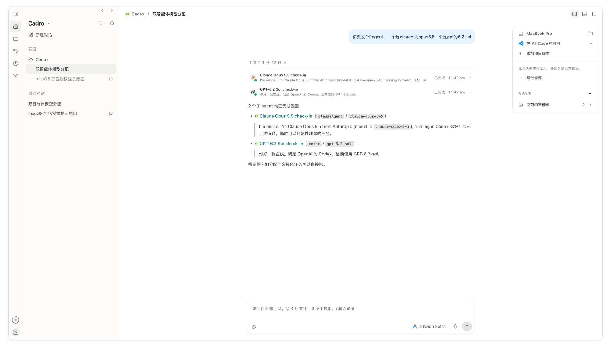
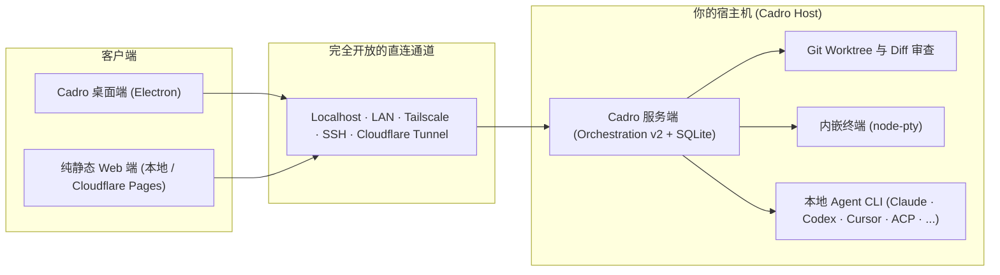

<p align="center">
  
</p>

<h1 align="center">Cadro</h1>

<p align="center">
  <strong>开源、可完全自部署的多 Coding Agent 工作台。</strong><br />
  Codex 风格桌面与 Web 界面 · 多 Agent 协同派发 · 零遥测 · 零闭源中继
</p>

<p align="center">
  <a href="https://github.com/AnnaSuSu/Cadro/releases/latest">
    
  </a>
  <a href="https://github.com/AnnaSuSu/Cadro/actions/workflows/ci.yml">
    
  </a>
  <a href="./LICENSE">
    
  </a>
  
  <a href="#零遥测源码审计">
    
  </a>
</p>

<p align="center">
  <a href="https://github.com/AnnaSuSu/Cadro/releases/latest"><strong>下载客户端</strong></a> ·
  <a href="#快速开始">快速开始</a> ·
  <a href="#自部署方案">自部署</a> ·
  <a href="#零遥测源码审计">源码审计</a> ·
  <a href="#路线图">路线图</a> ·
  <a href="./README.md">English</a>
</p>

<p align="center">
  
</p>

<p align="center">
  <em>同一个工作区，驱动所有本地编程智能体 —— 在同一对话中并行派发 Claude Code、Codex、Gemini 等多模型协作。</em>
</p>

---

Cadro 直接连接你本机已安装并登录的 Coding Agent CLI，提供统一、克制且高效的桌面端与 Web 工作台。不转售 Token、不绑定第三方云账号，也没有闭源中继服务挡在你和代码仓库之间。

## 核心特性

- **多 Agent 协同编排** — 直接使用你自己的模型订阅与本地 CLI。支持在会话中途切换模型，或在同一个工作区里并行派发多个不同提供商的子 Agent（如 Claude Code 与 Codex），统一汇总结果。
- **Codex 风格界面体验** — 极简左侧图标导航栏、`项目` + `最近对话` 分组侧边栏、居中对话主画布、侧边 Diff 审查视图、内嵌终端、实时用量配额环，以及浅色 / 深色 / 跟随系统主题。
- **内置 Git Worktree 与源码控制** — 每个并行会话可隔离在独立 Git Worktree 中，直接在工作台内查看 Diff、提交、推送并管理 Pull Request。
- **零遥测 · 零 Clerk · 零闭源中继** — 默认不发送任何产品分析或埋点数据，无第三方登录锁死，无设备数量上限。配对 Token 与会话状态全部托管在你自己的 Cadro 服务端；可选的 OpenTelemetry 导出仅发往你主动配置的端点。
- **自由自部署（Cloudflare Pages + Tunnel / Tailscale / LAN）** — 前端可打包为纯静态站点直接部署到 **Cloudflare Pages**，通过 **`cloudflared` Tunnel**、**Tailscale HTTPS**、**局域网** 或 **SSH** 直连你自己的宿主机。
- **开放桌面端自编译** — 无需商业签名账号即可从源码直接编译 Electron 桌面端，并打包 macOS、Linux、Windows 安装包。

## 支持的智能体

只需在运行 Cadro 服务端的机器上安装并登录对应 CLI 即可使用：

| 智能体             | 宿主机配置方式                                                                                        |
| :----------------- | :---------------------------------------------------------------------------------------------------- |
| **Claude Code**    | 运行 `claude auth login`                                                                              |
| **Codex**          | 运行 `codex login` 或在设置中直接连接 ChatGPT                                                         |
| **Cursor**         | 运行 `agent login`                                                                                    |
| **OpenCode**       | 运行 `opencode auth login`                                                                            |
| **Antigravity**    | 在 **设置 → 提供商** 中登录 Google 账号                                                               |
| **Grok Build**     | 运行 `grok login`                                                                                     |
| **Kiro**           | 运行 `kiro-cli login`                                                                                 |
| **Pi**             | 运行 `pi` 后执行 `/login`                                                                             |
| **Muse Code**      | 运行 `muse login`                                                                                     |
| **fx**             | 运行 `fx login`                                                                                       |
| **ACP 协议智能体** | 在 **设置 → 提供商** 中添加 GitHub Copilot 及其他 [ACP 协议](./docs/user/install.md#providers) 智能体 |

多账号实例、自定义 Base URL 与 CLI 路径配置请参阅 [安装与提供商配置](./docs/user/install.md#providers)。

## 系统架构

你的代码仓库、登录凭证与会话状态始终留在自己的宿主机上；客户端通过本地或自建通道直连服务端，链路中无任何闭源云中继。



## 快速开始

### 1. 下载桌面客户端

前往 [最新桌面版 Release](https://github.com/AnnaSuSu/Cadro/releases/latest) 下载对应系统的安装包（每次发布均附带 `SHA256SUMS` 校验文件）：

| 平台        | 架构                    | 安装包          |
| :---------- | :---------------------- | :-------------- |
| **macOS**   | Apple Silicon (`arm64`) | `.dmg`          |
| **macOS**   | Intel (`x64`)           | `.dmg`          |
| **Linux**   | `x64`                   | `.AppImage`     |
| **Windows** | `x64`                   | `.exe` 安装程序 |

### 2. 本地源码运行

环境要求：**Node.js 24.10+** 与 **Corepack**：

```sh
git clone https://github.com/AnnaSuSu/Cadro.git
cd Cadro
corepack enable pnpm
corepack pnpm install --frozen-lockfile && corepack pnpm dev
```

打开终端输出的配对链接，添加本地项目目录，即可选择已配置的智能体开始对话。

### 3. 本地自编译桌面端

```sh
corepack pnpm build:desktop
corepack pnpm start:desktop
```

<details>
<summary><strong>从源码打包各平台安装包</strong></summary>

请在目标操作系统上执行对应打包命令（产物输出至 `release/`）：

| 宿主机平台            | 打包命令                      |
| :-------------------- | :---------------------------- |
| macOS (Apple Silicon) | `pnpm dist:desktop:dmg:arm64` |
| macOS (Intel)         | `pnpm dist:desktop:dmg:x64`   |
| Linux (`x64`)         | `pnpm dist:desktop:linux`     |
| Windows (`x64`)       | `pnpm dist:desktop:win:x64`   |

Rust 目标工具链与原生依赖说明请查看 [桌面端自编译指南](./docs/DEPLOY.md#desktop-self-build)。

</details>

## 自部署方案

将 Cadro 服务端运行在存放代码和 Agent CLI 的机器上，通过完全由你掌控的网络方式远程访问：

| 方案                          | 说明                                                                                                              |
| :---------------------------- | :---------------------------------------------------------------------------------------------------------------- |
| **Cloudflare Pages + Tunnel** | 将 `apps/web/dist` 纯静态产物部署到 Cloudflare Pages，宿主机运行 `cloudflared` 隧道提供 HTTPS 与 WebSocket 通道。 |
| **Tailscale HTTPS**           | 通过私有 Tailnet 直接访问（`pair --tailscale`），自带 HTTPS 证书。                                                |
| **可信局域网 (LAN)**          | 绑定宿主机局域网 IP 与 `3773` 端口，使用一次性配对 Token 接入。                                                   |

完整配置命令与 GitHub Actions 自动部署流程请查看 [部署指南](./docs/DEPLOY.md)。

## 零遥测源码审计

在仓库根目录执行以下命令，可一行核验所有生产源码与依赖清单中**不存在**已知的埋点 SDK、Clerk 认证包或 T3 托管中继域名：

```sh
git grep -niE '@clerk/|electron-webauthn|clerk\.accounts\.dev|posthog-(js|node)|posthog\.com|api\.segment\.io|amplitude\.com|sentry\.io|(connect|relay)\.t3\.codes' \
  -- apps packages package.json pnpm-workspace.yaml pnpm-lock.yaml \
  ':(exclude,glob)**/*.test.*' ':(exclude,glob)**/i18n/**'
```

无任何匹配项时，`git grep` 将以退出码 `1` 结束。你也可以在浏览器中打开 **DevTools → Network**，刷新页面并新建对话核查所有前端请求；各模型提供商的 API 流量仅由运行对应 CLI 的宿主机直接发起。

## 相关文档

- [安装与智能体配置](./docs/user/install.md)
- [自部署与桌面端自编译指南](./docs/DEPLOY.md)
- [后台常驻服务配置](./docs/user/background-service.md)
- [项目设置与 Worktree 清理](./docs/user/project-settings.md)
- [用量与提供商配额](./docs/user/usage.md)
- [升级与更新说明](./docs/user/updating.md)
- [常见问题 (FAQ)](./docs/user/faq.md)

## 路线图

- [ ] **跨客户端统一 MCP 层（Unified Cross-Harness MCP Layer）** — 在 Cadro 中按全局或项目维度配置一次 MCP Server，自动注入并同步到 Claude Code、Codex、ACP 等各类底层 Harness。_（当前版本沿用各智能体自身的 MCP 配置。）_

## 开源协议与致谢声明

Cadro 基于 [MIT 协议](./LICENSE) 开源。

本项目的核心编排与 Provider 内核衍生自 MIT 开源项目 [`pingdotgg/t3code`](https://github.com/pingdotgg/t3code)。Cadro 为独立维护的非官方开源项目，与 T3 Tools, Inc. 无任何隶属、背书或维护关系。

[开源协议](./LICENSE) · [第三方声明](./THIRD-PARTY-NOTICES.md)
